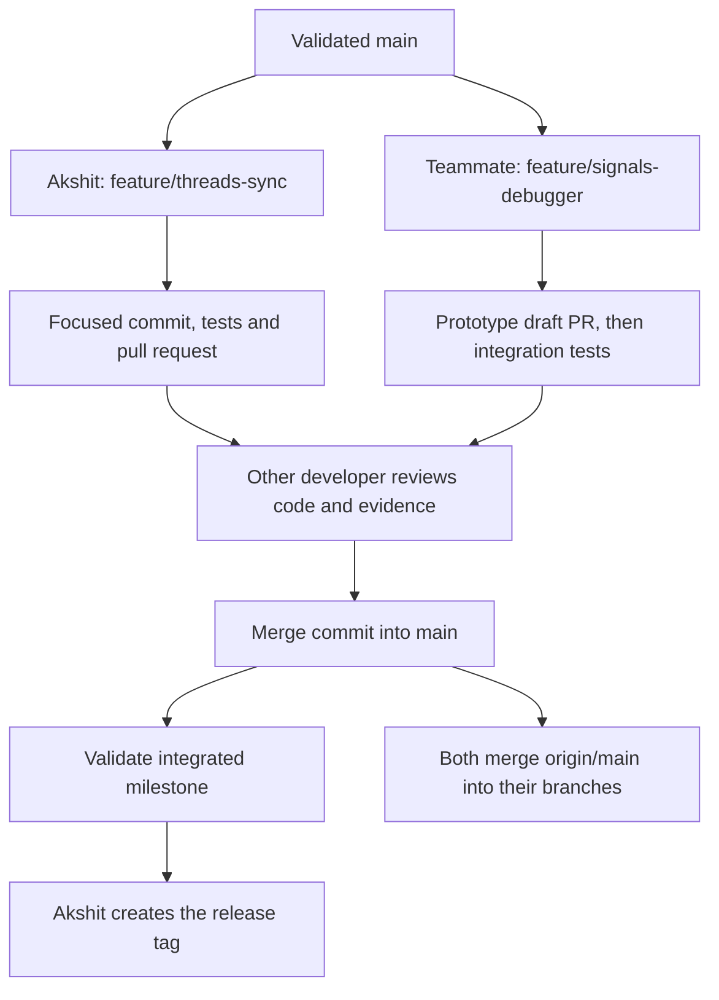

# Working together

Both developers use this repository with their own local clone, Git identity and GitHub account. The main branch presents integrated, validated work. Feature branches preserve each person's contributions while implementation is in progress.

## Responsibilities and dependencies

| Developer | Branch | Work |
| --- | --- | --- |
| Akshit | `feature/threads-sync` | v0.5–v0.9: thread-ready memory, kernel threads, futex, synchronization library and demonstrations |
| Nikunj Trehan (`nikunjtrehan`) | `feature/signals-debugger` | Tracing prototype now; v0.10–v0.13: tracing integration, signals, debugger protocol and tool |

Nikunj has pushed the standalone tracing prototype in [draft PR #2](https://github.com/AkshitMishra1107/os_project_xv6_plus/pull/2). Full Part 3 integration depends on the v0.9 thread interfaces. A standalone tracing prototype may be committed and pushed now, but its PR stays draft until the thread-dependent hooks and tests are complete. Each developer uses their own GitHub account and needs write access to push to the shared repository.



## Teammate first setup

If work already exists in a local clone, continue there and save it in a focused local commit before merging updates. The clone command below is for a new checkout.

```bash
git clone https://github.com/AkshitMishra1107/os_project_xv6_plus.git xv6-plus
cd xv6-plus
git switch feature/signals-debugger
git config --local user.name "YOUR NAME"
git config --local user.email "YOUR GITHUB VERIFIED OR NOREPLY EMAIL"
git config --local core.autocrlf input
git fetch origin
git merge origin/main
```

Replace the identity placeholders before running those two configuration commands. Set your own identity; do not use Akshit's name or email. Existing clones should check `git status --short` before merging. Save unfinished changes in a clearly labelled feature-branch commit, or finish the current edit before updating.

## Where contributions belong

- Kernel implementation: `kernel/`. User commands and tests: `user/`. Register new user programs in `Makefile`.
- Explanation and a Mermaid diagram: `docs/features/<feature>.md`.
- Measured results and commands: `docs/results/<feature>/README.md`.
- Selected screenshots: `docs/results/<feature>/screenshots/` with meaningful names such as `trace-inheritance.png`.
- Small, relevant output records: `docs/results/<feature>/outputs/`. Label command, configuration, commit and whether output is observed or illustrative.

Publish a feature's purpose, mechanism, code links, previous behavior, new behavior and observed validation. Update the root README when a capability is integrated and validated. Keep planned or prototype capabilities explicitly labelled.

Full implementation manuals, duplicate screenshots, editor captures, raw build scrollback, intermediate patch exports and personal working notes remain in the local report/team archive. Add a concise bug explanation publicly only when it helps a reviewer understand the implementation or a limitation.

## One focused commit at a time

```bash
git status --short
git diff
git diff --check
git add -p
```

`git add -p` stages selected edits to tracked files (`y` includes a hunk, `n` skips it). Add each intended new source, feature page, result or screenshot by its exact path. Avoid staging generated binaries, raw archives or unrelated experiments.

For example, after creating these files for the tracing contribution:

```bash
git add user/trace.c docs/features/tracing.md
git diff --cached --check
git diff --cached --stat
git diff --cached
git commit -m "trace: add standalone syscall tracing prototype"
git push -u origin feature/signals-debugger
```

The example paths must exist and the tracked kernel/Makefile wiring must also be selected. Use small, meaningful commits such as `trace: inherit masks in fork`, `test: check tracing filters`, and `docs: explain tracing with observed output`. Each commit remains associated with its real author.

## Pull requests and synchronization

Open a pull request from your feature branch to `main`. Explain the feature and before/after behavior, identify the commit and exact configuration tested, link selected evidence and state remaining dependencies. Keep incomplete work draft. The other developer reviews shared interfaces and checks results. Use **Create a merge commit** when the PR is ready, preserving individual commits. Keep both long-lived feature branches.

After a main-branch update, in a clean or safely committed checkout:

```bash
git fetch origin
git switch feature/signals-debugger
git merge origin/main
git push origin feature/signals-debugger
```

Akshit uses the same sequence with `feature/threads-sync`. Resolve conflicts deliberately, then rebuild and test before pushing. To stop an unresolved merge and return to its starting state, use `git merge --abort`. Never resolve a shared file by blindly replacing the other person's implementation, force-pushing shared history, or moving an existing tag.

## Shared interfaces

| Interface | Agreement |
| --- | --- |
| System calls | memstat 22; threads 23–26; futex 27–28; trace 29; signals 30–33; debugger 34–39 |
| Thread memory | Leader owns shared size/page table; preserve ptlock ownership, per-thread trapframes and lifecycle behavior |
| Trace lifecycle | Final integration includes fork and kthread_create inheritance, plus freeproc and reap_thread reset |
| Shared files | Coordinate proc.h/proc.c, trap.c, syscall.c/syscall.h, sysproc.c, defs.h, Makefile, user.h and usys.pl |
| Configurations | Swap pressure: one CPU and 8 MB usable RAM; normal memory regression: one CPU and 128 MB; later parallel thread demos: three CPUs and 128 MB |

Use only implemented syscall names in the prototype. A trace bitmask of type int can safely select syscall numbers 1 through 30 with the agreed interface; debugger syscalls above that range need a separate design rather than unsafe shifts.

## Testing and release evidence

For a clean normal memory build use `make clean` followed by `make qemu CPUS=1 RAM_MB=128 SWAP_POLICY=1`. Run the feature's focused tests, earlier memory demonstrations and full usertests when shared kernel paths change. For swapping, rebuild one-CPU 8 MB configurations under both policies and check memhog and swapfork. Record real observations; never substitute expected output for an executed test.

Capture the useful result, command and configuration. Keep only the clearest screenshot for each distinct result and put its filename in the result page. Before/after comparisons must identify both versions and use comparable configurations.

Akshit creates an official release tag only after the milestone PR is merged and integrated main passes its checks. A commit message mentioning a version does not by itself validate that release. The v0.5 work remains in development until its new validation evidence is complete.
