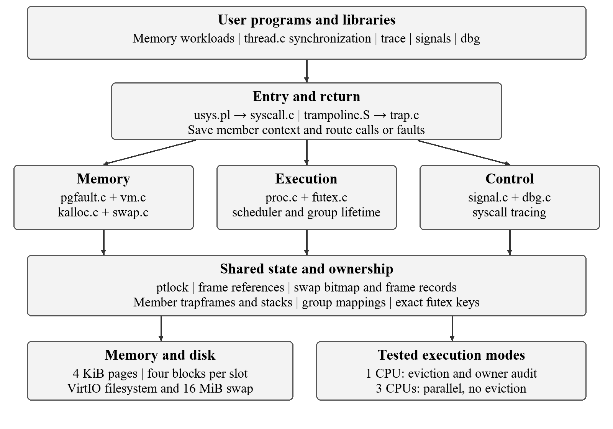
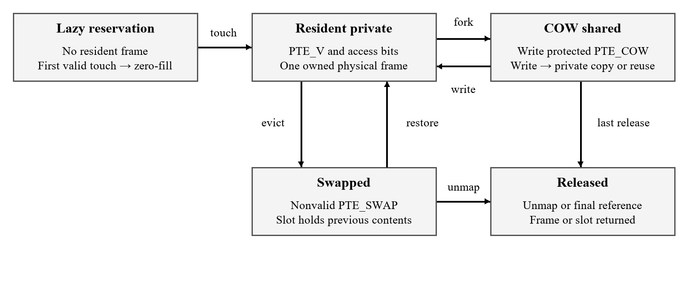

# Architecture and source map

User stubs enter syscall dispatch; traps save a member-specific context and route faults, signals and debug events. Threads share group mappings and heap state while retaining their own TID, stacks and trapframe. ptlock protects mappings and pinned copies; reference counts and swap records track backing ownership. Disk I/O releases spinlocks before sleeping.

One CPU supports eviction and complete swap ownership audit, including the combined worker/signal/paging test. Three CPUs support parallel execution with eviction disabled. Multithreaded fork copies privately until remote TLB shootdown is available. Syscall numbers 22–41 cover memory, threads/futexes, trace, signals, debugging, ownership audit and microsecond time.

## Complete source-purpose inventory

Statuses compare the current implementation with historical MIT c4de4b0. Created modules may have been extended across later milestones. FIFO and Clock are branches in swap.c, not separate policy files. usertests.c is inherited and unchanged.

| File | Status | Purpose and impact |
|---|---|---|
| `Makefile` | Modified | Registers objects/libraries/programs; CPU/RAM/policy/COW definitions and fixed swap backing. |
| `kernel/console.c` | Modified | Emits CR before LF so serial bytes lay out correctly in the native virtual console; write return counts are unchanged. |
| `kernel/dbg.c` | Added | Implements six direct child control calls with exec breakpoint and exit reasons plus safe abandoned target handling. |
| `kernel/dbg.h` | Added | Defines stop reasons and the PC stack frame return and argument register snapshot exported to the debugger. |
| `kernel/defs.h` | Modified | Declares added memory thread futex signal debugger and statistics helpers so original modules can call them consistently. |
| `kernel/exec.c` | Modified | Rejects unsupported multi member exec and resets caught signal state when installing a new user image. |
| `kernel/futex.c` | Added | Implements 64 keyed buckets expected value wait exact key wake and waiter records shared with proc sleep states. |
| `kernel/kalloc.c` | Modified | Adds kref helpers and free page accounting; kfree releases a physical page only after its last reference. |
| `kernel/main.c` | Modified | Initializes swap metadata page table locking futex buckets and signal state before user processes start. |
| `kernel/memlayout.h` | Modified | Derives PHYSTOP from RAM_MB and reserves separate trapframe virtual addresses with a shared user limit. |
| `kernel/memstat.h` | Added | Defines the seven field structure copied by sys_memstat and read by monitoring and workload programs. |
| `kernel/param.h` | Modified | Defines MAXTHREADS and expands filesystem capacity for the added executable set; does not increase managed RAM. |
| `kernel/pgfault.c` | Added | Created for lazy faults then extended for COW swap permissions and concurrent first touch; handle_page_fault rechecks mappings after allocations. |
| `kernel/pipe.c` | Modified | Stages pipe data so memory recovery and potentially sleeping copies happen outside the pipe spinlock. |
| `kernel/proc.c` | Modified | Adds thread creation join group exit and kill; COW versus private fork selection; trace and signal inheritance; safe reap and debugger abandonment. |
| `kernel/proc.h` | Modified | Adds leader TID member and trapframe metadata plus trace mask pending signals saved handler context and debugger stop state. |
| `kernel/riscv.h` | Modified | Adds COW and swap software flags accessed bit and swap slot encode decode macros used by VM recovery and replacement. |
| `kernel/sigdefs.h` | Added | Defines namespace size supported named signals and default ignore dispositions used by both kernel and user wrappers. |
| `kernel/signal.c` | Added | Implements signal_init pending delivery handler registration send pause and trapframe restoration through sigreturn. |
| `kernel/spinlock.c` | Modified | Exposes interrupt disable nesting through nlocks_held to avoid entering sleepable reclaim from protected contexts; not an exact ownership census. |
| `kernel/swap.c` | Added | Frame and slot tracking, disk transfer, FIFO/Clock/seeded Random selection, counters and ownership audit. |
| `kernel/swapaudit.h` | Added | Defines bounded owner and slot records and bitmap/PTE reconciliation totals. |
| `kernel/syscall.c` | Modified | Registers the new handlers and names; uses leader size in argument checks and prints selected returns through a guarded trace mask. |
| `kernel/syscall.h` | Modified | Registers added calls 22–41, including swapcheck and microsecond time. |
| `kernel/sysfile.c` | Modified | Prefaults I O buffers and stops an opted in debugger target after a successful exec image installation. |
| `kernel/sysproc.c` | Modified | Changes heap growth to shared lazy reservation and exposes memstat threads trace and interruptible sleep handling. |
| `kernel/trampoline.S` | Modified | Replaces the fixed trapframe assumption with sscratch and per member trapframe selection on entry and return. |
| `kernel/trap.c` | Modified | Classifies faults dispatches breakpoint stops delivers signals and returns through the current member trapframe with instruction synchronization. |
| `kernel/vm.c` | Modified | Supports holes COW swap unmapping shared lock protected copies private threaded fork and constrained debugger code writes. |
| `user/baseline.c` | Added | Requests 200 MiB through sbrk and prints success or failure; does not touch the entire reservation. |
| `user/cowtest.c` | Added | Touches 80 MiB forks checks inherited patterns and verifies child writes do not change parent values. |
| `user/dbg.c` | Added | Loads ELF function symbols handles breakpoint patch and software step over and prints registers and bounded frame traces. |
| `user/dbglife.c` | Added | Eight controllers abandon stopped targets; checks completion without recursive wait lock acquisition and rejection of traced threads. |
| `user/dbgmini.c` | Added | Creates an opted in exec child reads its registers and instruction bytes continues it and observes exit reason three. |
| `user/dbgtarget.c` | Added | Uses noinline outer middle and inner functions; final outer five result must be twelve. |
| `user/exittest.c` | Added | Worker calls process exit and external parent verifies whole group termination with status three. |
| `user/finaldemo.c` | Added | Real workers, full-page patterns, barrier, mutex, child signal and pressure option. |
| `user/forkbench.c` | Added | Read-only/write-all children, fully touched 20 MiB parent, checked data and microsecond timing. |
| `user/futextest.c` | Added | Checks 200 handshakes mismatch invalid addresses exact key isolation and termination behavior. |
| `user/hotcold.c` | Added | Creates a 12 MiB locality pattern for three rounds and prints measured phase swap deltas after initialization. |
| `user/kthreadtest.c` | Added | Checks limits invalid creation identity joins slot reuse threaded fork and exec restrictions. |
| `user/lazytest.c` | Added | Reserves 256 MiB touches every hundredth page checks zero fill and lazy syscall buffers; reports 656 write touched pages. |
| `user/libtest.c` | Added | Checks nested create join mutex increments a condition barrier and semaphore coordination including allocation metadata. |
| `user/memhog.c` | Added | Fills and verifies every byte of each requested page and checks child status. |
| `user/memstat.c` | Added | Prints the seven statistics returned by memstat; it is an observer rather than a pressure workload. |
| `user/pagebench.c` | Added | Four seeded access patterns, checked stream, microsecond timer and full-page verification. |
| `user/pagepattern.h` | Added | Position/page/seed-dependent 32-bit pattern fills and verifies every byte. |
| `user/philosophers.c` | Added | Five workers acquire forks in a fixed ascending order and each completes 20 meals. |
| `user/prodcons.c` | Added | Two producers and two consumers coordinate capacity eight and verify item count total and multiplicity. |
| `user/racetest.c` | Added | Barrier-forced lost-update interleaving compared with mutex protection. |
| `user/semtest.c` | Added | Six workers perform 60 operations with two permits and verify peak concurrent use does not exceed two. |
| `user/sig.c` | Added | Implements signal registration convenience and the user restorer that invokes sigreturn after a handler returns. |
| `user/sig.h` | Added | Exposes shared signal constants and the convenience wrapper to signal tests and applications. |
| `user/sigtest.c` | Added | Checks self delivery state preservation interprocess pause default termination ignore and interrupted sleep. |
| `user/speedup.c` | Added | Equal total global index range across worker counts, checked unsigned sum and microsecond timing. |
| `user/swapcheck.c` | Added | Prints owner PID/state/VA, slot IDs and reconciliation errors. |
| `user/swapfork.c` | Added | Checks first bytes across a fork while child writes second bytes and parent verifies isolation under pressure. |
| `user/thread.c` | Added | Creates and reclaims 16 KiB stacks; implements mutex condition semaphore and TID reuse safe join bookkeeping. |
| `user/thread.h` | Added | Declares real library functions and state types; replaces the development branch sequential placeholder header during integration. |
| `user/threadcheck.h` | Added | Provides common checked assertion reporting used by thread and synchronization tests; no kernel service itself. |
| `user/threadlife.c` | Added | Verifies worker triggered process exit status and whole group kill with parent observation. |
| `user/threadmem.c` | Added | Concurrent lazy first touch shared unique sbrk growth and inherited COW visibility without intervening reader syscalls. |
| `user/threadswap.c` | Added | Four workers write and verify boundary words across 3072 shared pages with a condition barrier. |
| `user/threadtest.c` | Added | Partitions a sum and checks the combined shared result equals 499500. |
| `user/trace.c` | Added | Parses a mask sets tracing and execs a chosen program so selected calls and child activity become visible. |
| `user/tracethread.c` | Added | Checks inherited kgettid tracing with a real member then absence of stale trace events after disabling and reusing slots. |
| `user/user.h` | Modified | Declares memory thread futex tracing signal and debugger calls and required shared structure forward declarations. |
| `user/usys.pl` | Modified | Adds entries that generate assembly ecall wrappers for every implemented user kernel interface. |

Textual diff: 4,711 insertions and 197 deletions across 68 source/build files; comments, tests and formatting are included. See [raw per-file statistics](results/validation-upgrade/data/source-diff.csv). The additional tools/ runner and independent checks are documented in [tools/README.md](../tools/README.md).
