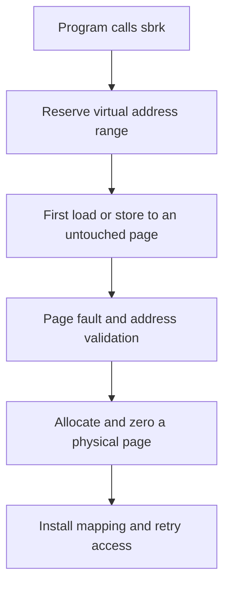
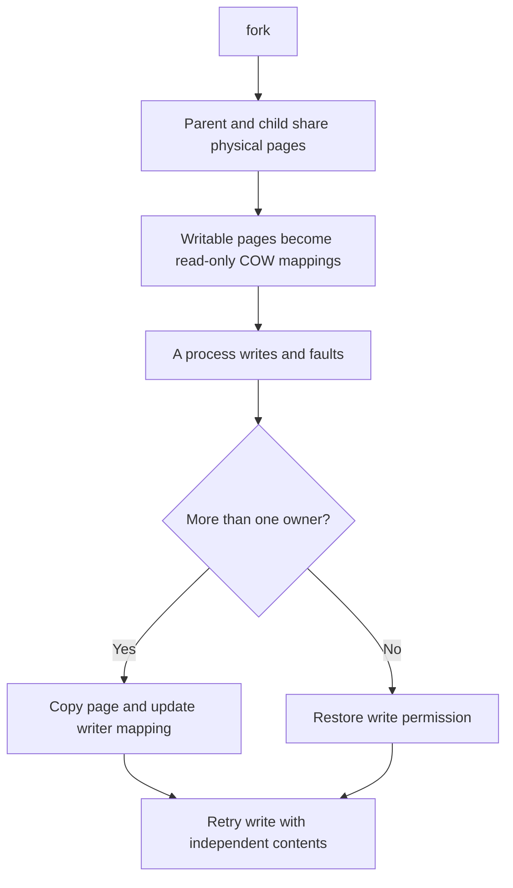
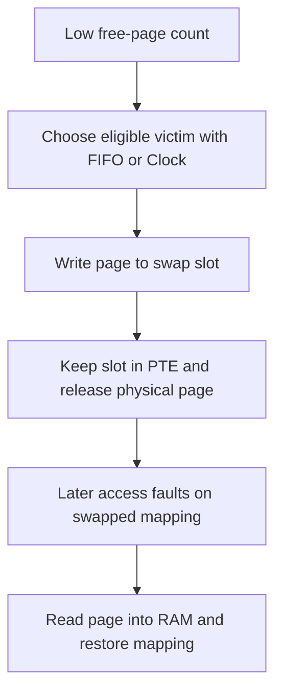
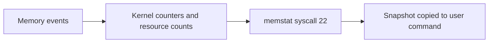

# Memory extensions

This page explains the validated memory work through tag `v0.4`. The [results](../results/memory/README.md) compare recorded checkpoints. Future thread and debugger capabilities are not included in these completed-feature claims.

## Lazy allocation

In the eager baseline, `sbrk(n)` tried to allocate physical pages immediately. Our implementation grows the process's virtual size first. A load or store to an untouched page enters the fault handler, which validates the address, allocates a page, zeroes it and installs a user mapping. An allocation failure or an illegal access ends the process appropriately.

**Added capability:** sparse programs can reserve a large range while backing only accessed pages. The successful 200 MB reservation is a virtual reservation; it does not show 200 MB resident in RAM.

**Code:** [`sys_sbrk`](../../kernel/sysproc.c), [`handle_page_fault`](../../kernel/pgfault.c), and mapping/unmapping helpers in [`vm.c`](../../kernel/vm.c). **Demonstrations:** [`baseline.c`](../../user/baseline.c) and [`lazytest.c`](../../user/lazytest.c).

## Copy-on-write fork

Our earlier fork path copied resident user pages into the child. COW instead maps the same physical page into both processes. Originally writable pages lose write permission and gain a software COW flag. Reference counts record sharing. On a write fault, the kernel copies the page if multiple owners remain; with one owner, it can restore write permission directly. Parent and child retain independent contents after a write.

**Added capability:** fork avoids an immediate full copy, helping large processes fork and reducing the cost of fork followed by exit or exec. This does not remove the cost of pages that are later privately written.

**Code:** [`uvmcopy` and user-copy helpers](../../kernel/vm.c), [`PTE_COW`](../../kernel/riscv.h), [`kref_inc`, `kref_get` and `kfree`](../../kernel/kalloc.c), and [`fault handling`](../../kernel/pgfault.c). **Demonstrations:** [`cowtest.c`](../../user/cowtest.c), [`forkbench.c`](../../user/forkbench.c), and [`swapfork.c`](../../user/swapfork.c).

## Disk swapping and replacement policies

Lazy allocation alone cannot provide physical pages once usable RAM is exhausted. The swap engine tracks eligible resident pages. Under pressure it selects a victim, writes its 4 KB contents into the reserved disk area, replaces its mapping with a swap-slot entry and releases the physical page. A later access faults the page back into RAM with its permissions restored.

FIFO selects the oldest tracked eligible page. Clock examines the accessed bit, gives a recently used page another chance, and advances its hand. Shared COW pages are excluded from eviction in this implementation; the engine does not provide arbitrary multiprocessor swapping.

**Added capability:** the recorded 12 MB workload completes with 8 MB of usable xv6 RAM and a 16 MB swap area. Swapping trades disk I/O for additional working-set capacity; it does not make disk as fast as RAM or remove the finite capacity limit.

**Code:** [`swap.c`](../../kernel/swap.c), [`PTE_SWAP` and slot encoding](../../kernel/riscv.h), [`page faults`](../../kernel/pgfault.c), [`memory limit`](../../kernel/memlayout.h), and image/configuration rules in the [`Makefile`](../../Makefile). **Demonstrations:** [`memhog.c`](../../user/memhog.c), [`swapfork.c`](../../user/swapfork.c), [`hotcold.c`](../../user/hotcold.c).

## Memory statistics

`memstat` exposes page-fault handler calls, lazy allocations, actual COW page copies, swap outs, swap ins, free pages and used swap slots. Counters are cumulative since boot. A COW write that only restores write permission does not count as an actual page copy.

**Added capability:** programs and demonstrations can report which memory mechanisms ran and inspect resource recovery. These counters do not directly measure peak resident memory or elapsed time.

**Code:** [`memstat.h`](../../kernel/memstat.h), [`memstat_fill`](../../kernel/swap.c), [`sys_memstat`](../../kernel/sysproc.c), syscall wiring in [`syscall.c`](../../kernel/syscall.c), and [`user/memstat.c`](../../user/memstat.c).

## Integration repairs

User-memory copies can fault and require allocation or swap I/O. The final memory milestone stages pipe writes and performs pipe read user copies outside the pipe spinlock. Wait cleanup releases child memory and locks before copying status into the parent. These changes let the memory mechanisms operate through existing system calls. They are covered by the final full regression result.

**Code:** [`pipe.c`](../../kernel/pipe.c), [`wait` in proc.c](../../kernel/proc.c), and the unchanged regression suite [`usertests.c`](../../user/usertests.c).

## References and presentation

Lazy allocation and COW correspond to MIT labs; memstat is related to the sysinfo exercise but has a different interface. Swap and policy design are supported by standard VM references. See the [annotated primary references](../references.md), [draft memory report](../reports/memory-management-draft.docx), and [teacher evidence guide](../presentation/memory.md).
