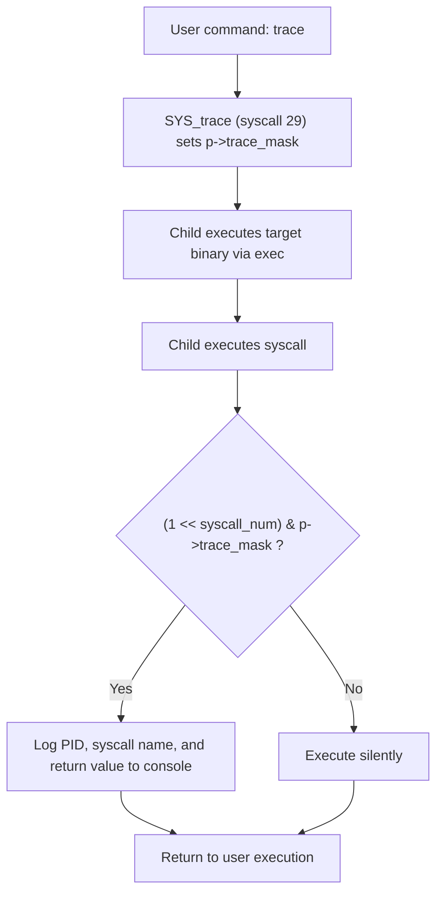
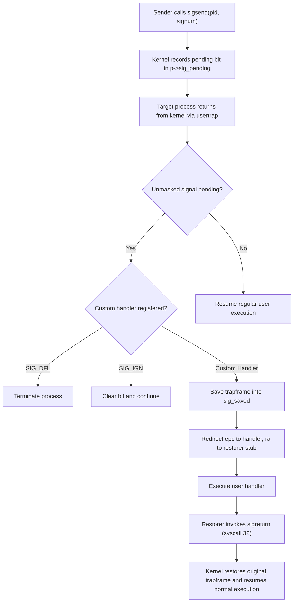
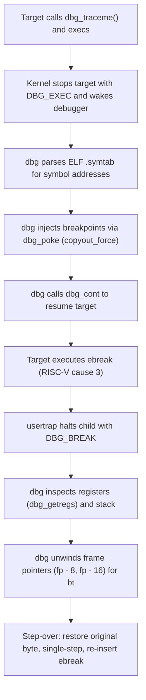

# Signals, Dynamic Tracing, and In-Kernel Debugger

This page explains the validated Part 3 work through milestone `v1.0`. The [results](../results/signals-debugger/README.md) compare recorded checkpoints against the stock xv6 baseline.

---

## 1. Dynamic System Call Tracing (`trace`)

In stock xv6, system calls execute silently without any runtime observability. System call tracing adds a dynamic mask to the process control block (`p->trace_mask`). When a process issues a system call matching its active mask, the kernel records and prints the calling PID, the system call name, and its return value.

**Added capability:**
- Dynamic per-process filtering: trace individual syscalls or combinations via bitmask (e.g. `trace 32 cat README` traces `read`; `trace 2 sh` traces `fork`).
- Fork inheritance: child processes created via `fork()` inherit the parent's `trace_mask`.
- Exec preservation: `trace_mask` persists across `exec()` into the new process image.

**Code:** [`sys_trace`](../../kernel/sysproc.c), [`syscall`](../../kernel/syscall.c), [`syscall.h`](../../kernel/syscall.h), [`proc.h`](../../kernel/proc.h).
**Demonstrations:** [`trace.c`](../../user/trace.c).

---

## 2. Asynchronous POSIX Signals & Handlers (`sigaction`, `sigreturn`)

Stock xv6 only provides an unconditional `kill(pid)` which marks a process `KILLED`. xv6-Plus introduces 16 asynchronous signals (`NSIG = 16`), custom user handlers, signal masking, and clean execution resumption.

**Added capability:**
- 16 distinct signals including `SIGHUP`, `SIGINT`, `SIGTERM`, `SIGUSR1`, `SIGUSR2`, and `SIGALRM`.
- `sigaction` registers user-space handler and transparent restorer trampoline.
- Transparent register preservation: user register state is preserved across handler execution via `sig_saved` and `sigreturn`.
- Inter-process signaling: wakes sleeping processes; `sleep()` returns `-1` early when interrupted; `pause()` suspends execution until a signal arrives.

**Code:** [`signal.c`](../../kernel/signal.c), [`sigdefs.h`](../../kernel/sigdefs.h), [`trap.c`](../../kernel/trap.c), [`sysproc.c`](../../kernel/sysproc.c).
**Demonstrations:** [`sig.c`](../../user/sig.c), [`sig.h`](../../user/sig.h), [`sigtest.c`](../../user/sigtest.c).

---

## 3. In-Kernel Debugger Primitives & The `dbg` Tool

Stock xv6 lacks any runtime introspection; breakpoint instructions (`ebreak`) crash processes, and text segment pages are strictly read-only. xv6-Plus adds non-fatal breakpoint trapping, forced copyout through write-protected text pages, and a full native userland debugger CLI.

**Added capability:**
- In-kernel debugger protocol: `dbg_traceme`, `dbg_wait`, `dbg_cont`, `dbg_getregs`, `dbg_peek`, `dbg_poke`.
- `copyout_force()`: safely writes through read-only text segment pages to inject software breakpoints (`ebreak` and `c.ebreak`) accompanied by `fence.i` instruction cache flushes.
- Interactive userland CLI (`dbg`): breakpoints by function name or address, register inspection (`regs`), instruction stepping, and resume (`continue`).
- Symbolized call stack backtraces (`bt`): walks the RISC-V frame pointer chain and maps return addresses to ELF symbol table function names and offsets.

**Code:** [`dbg.c`](../../kernel/dbg.c), [`dbg.h`](../../kernel/dbg.h), [`vm.c`](../../kernel/vm.c), [`trap.c`](../../kernel/trap.c), [`sysfile.c`](../../kernel/sysfile.c).
**Demonstrations:** [`dbgmini.c`](../../user/dbgmini.c), [`dbg.c`](../../user/dbg.c), [`dbgtarget.c`](../../user/dbgtarget.c).

---

## 4. Multi-Subsystem Integration (`finaldemo`)

`finaldemo` verifies that the new Part 3 mechanisms operate concurrently with Part 1 (Lazy Memory Allocation) and Part 2 (Kernel Threading):
- Multiple threads allocate large sparse virtual memory buffers requiring demand-paged fault handling.
- Concurrently, inter-thread and inter-process signals are delivered and processed asynchronously.
- Memory statistics confirm zero memory leakage and accurate lazy page fault counting.

**Code:** [`finaldemo.c`](../../user/finaldemo.c), [`thread.h`](../../user/thread.h).
