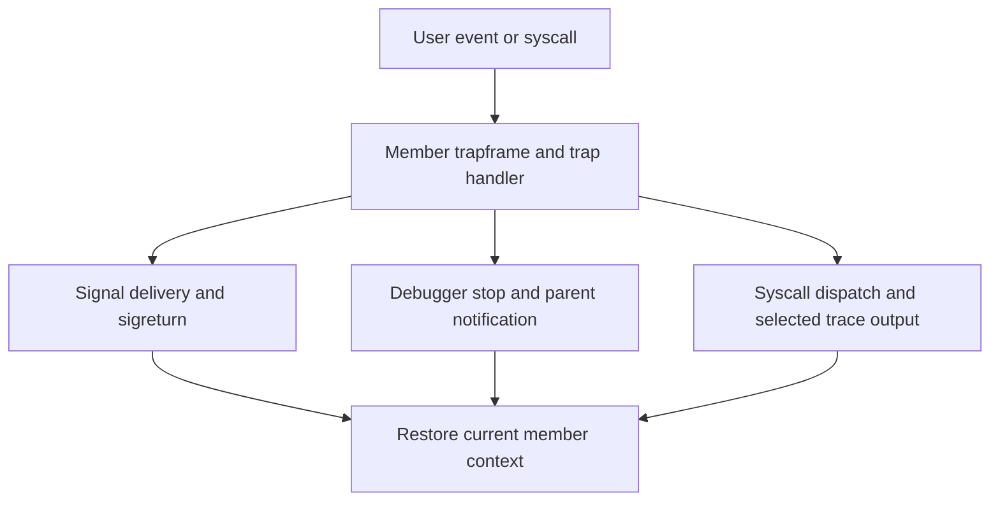

# Tracing signals and debugger

These mechanisms are integrated with the real thread and memory foundation. See [final combined results](../results/final-integration/README.md) and the [full report](../reports/xv6-plus-final-report.docx).

## Tracing

`trace(mask)` selects syscall returns by number. The dispatcher prints PID, syscall name and result; it does not print arbitrary arguments. Fork and kthread_create inherit masks; reap resets them. Exec preserves the mask. The guarded int mask selects numbers below 31, so debugger calls 34–39 are outside its range. `tracethread` checks inheritance and disabled-mask slot reuse.

## Signals

`sigaction`, `sigsend`, `sigreturn` and `pause` implement a compact Unix-inspired API. NSIG=16 gives numbers 1–15; SIGKILL remains uncatchable. A process-directed send targets the leader, stores a pending bit and delivers on a user-trap return. Custom delivery saves the trapframe, invokes a handler and returns through a user restorer. Ignore/default behavior and interruptible sleep are tested by sigtest.

This is **not full POSIX signals**: there is no blocked-mask API, queued realtime signals, alternate signal stack or automatic alarm generator. Repeated sends of the same signal can coalesce. Delivery/handler state is per execution context; the group leader receives process-directed events.

## Debugger

A direct single-context child opts in with dbg_traceme. It stops after exec and on breakpoint exceptions. Six kernel calls provide wait/continue, a register snapshot, peek and poke, limited to 64 bytes per memory request. Debugging rejects multithreaded targets and traced targets cannot create workers. copyout_force follows ptlock ownership and refuses shared physical code frames. An abandoned stopped child is released and killed without recursively acquiring wait_lock.

`dbg program` reads ELF symbols and supports `break FUNC`, `run`, `continue`, `bt`, `regs`, `info`, and `quit`. Software step-over uses a temporary next-instruction breakpoint and rejects unsupported control-flow breakpoint sites; there is no general hardware step command or arbitrary attach service. Backtraces are best effort and stop at the entry stub. `dbglife` exercises eight abandoned stopped targets and the traced-thread guard.

## Integration demonstration

`finaldemo` uses the actual thread library: three workers with nonzero TIDs touch 1536 pages in separate lazy regions, update a mutex-protected total, join and receive SIGUSR1. The earlier branch's temporary sequential thread header is not the integrated implementation. Its historical finaldemo screenshot is not evidence of actual kernel concurrency. Fresh final results replace that claim; no leak-free claim follows from the demo alone.

Source: kernel/signal.c, kernel/dbg.c, kernel/proc.c, kernel/trap.c, kernel/syscall.c, kernel/vm.c, user/sig.c and user/dbg.c. [Primary references](../references.md) distinguish MIT trap/syscall exercises from this combined implementation.
