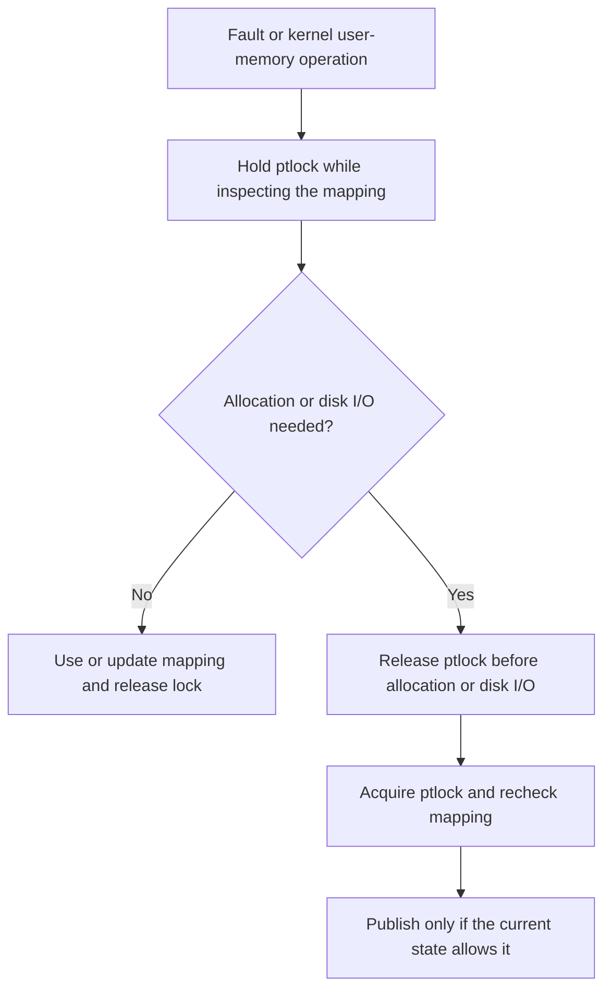

# Thread ready memory preparation

Milestone v0.5 prepares the existing memory subsystem for the later thread implementation. Its planned one-CPU regression and pressure checks have passed on the working candidate. Main-branch integration and the release tag are still pending. Runnable thread support is part of the later milestones.

## Before and after

| Area | v0.4 behavior | v0.5 preparation |
| --- | --- | --- |
| Mapping protection | Several operations relied on local interrupt guards | A shared page-table spinlock coordinates mapping inspection, updates, user copies and frame tracking |
| Shared address-space size | Size was read from the current proc | The leader owns size; sbrk changes and size snapshots use ptlock |
| Fault access type | A boolean distinguished writes from other faults | Read, write and execute are explicit access types; an already repaired valid mapping can be retried |
| Swap-in state | The old path assumed its saved mapping was still current | Rewalk after waiting and after I/O; publish only when the saved swapped entry still matches |
| Thread bookkeeping | No per-thread identity or reserved trapframe range | Add leader, tid, thread count, slot mask and trapframe address fields, plus an eight-thread limit and reserved addresses |

The purpose is to establish memory ownership and locking contracts before multiple kernel threads share an address space. The existing lazy allocation, COW and swapping demonstrations continue to work.

## Lock and retry flow

Successful pinning returns with ptlock held, and the copy caller releases it after accessing the page. Unmapping and tracking helpers preserve a lock already held by their caller. The swap sleep lock serializes disk operations; ptlock is released during the actual I/O. Initialization occurs before bootstrap page freeing, which already uses frame untracking.

## Code locations

- [Thread limit](../../kernel/param.h), [reserved trapframe addresses](../../kernel/memlayout.h) and [proc bookkeeping](../../kernel/proc.h).
- [Pinning, user copies, unmapping and COW sharing](../../kernel/vm.c).
- [Access-type fault handler](../../kernel/pgfault.c) and [trap access mapping](../../kernel/trap.c).
- [Swap synchronization, frame tracking and statistics](../../kernel/swap.c), initialized from [main](../../kernel/main.c).
- [Shared sbrk size](../../kernel/sysproc.c), [growth/shrink handling](../../kernel/proc.c) and [syscall address checks](../../kernel/syscall.c).

## Validation and scope

The normal 128 MB FIFO build passed baseline, lazytest, cowtest, forkbench and the full unchanged usertests suite. One-CPU 8 MB builds under both FIFO and Clock passed a 4 MB control, two 12 MB workloads and swapfork. See the [results and selected evidence](../results/thread-ready-memory/README.md).

These checks establish compatibility in the tested configurations. They do not exercise concurrent threads, and swapping remains supported with one CPU. Thread creation, futexes, synchronization primitives and thread lifecycle integration remain later work. Cross-CPU TLB invalidation is not added by this milestone.
