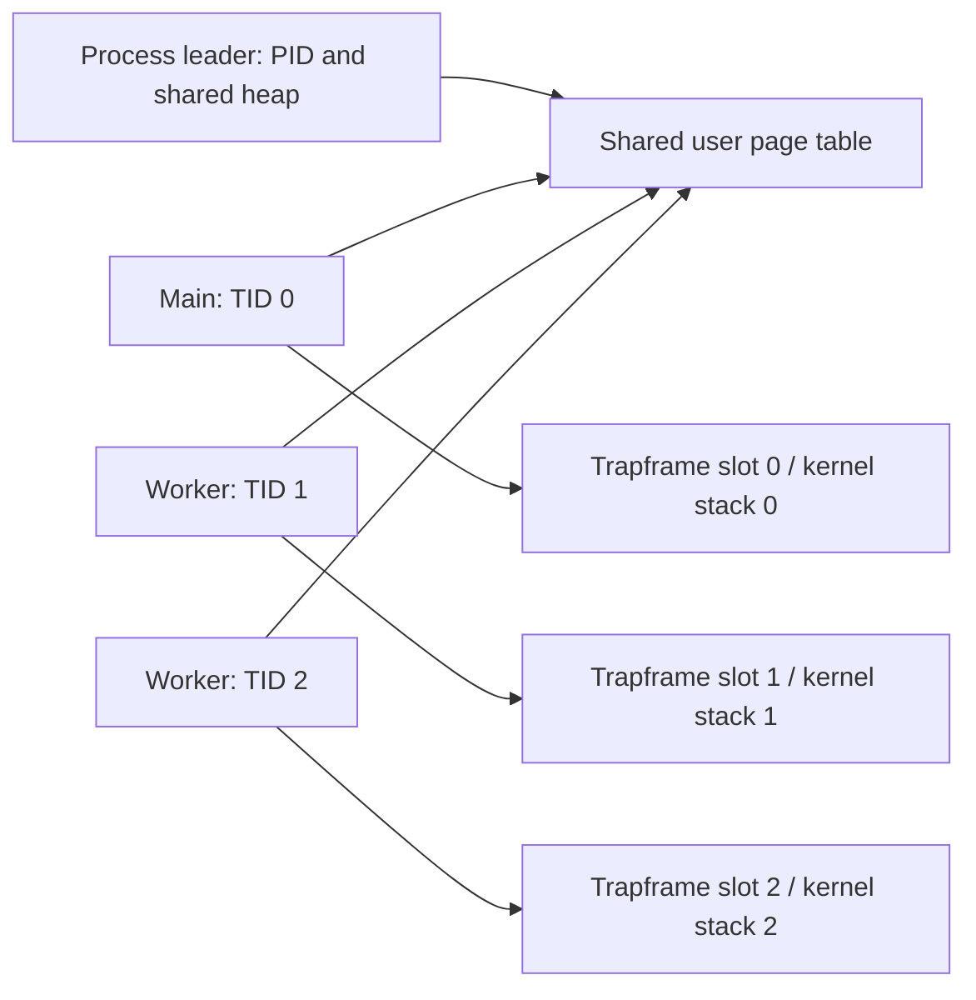

# Threads and synchronization

## Kernel threads (v0.6)

Ordinary xv6 `fork()` creates a separate address space. `kthread_create()` instead creates a schedulable member of the same process: the members share the PID, user page table and heap, while each has its own TID, kernel stack, user stack and trapframe. Up to eight members, including the main thread, are supported.

The trampoline exchanges the saved user register with `sscratch` to select the calling thread's trapframe. Creation publishes a thread only after all its resources are ready. Join reclaims its trapframe and TID slot without freeing the shared address space. A worker returning through the exit stub ends that worker; calling process `exit(status)` from any member ends the group, with the first group exit status preserved for the parent. `kill(pid)` wakes and terminates every member.

| Operation | Original process model | Thread implementation |
|---|---|---|
| Parallel work | Separate processes and memory | Threads share ordinary variables and heap |
| Identity | PID only | Shared PID and per-member TID |
| Waiting | `wait()` for child processes | `kthread_join(tid)` for members; `wait()` for process children |
| Trap return | Fixed trapframe VA | One reserved trapframe VA per member |
| Cleanup | Free one process address space | Reap member resources first, then free group memory |

## Concurrency boundaries

- `exec()` is accepted only in a group containing just its main thread.
- Heap shrink is rejected while multiple members exist. Growth is shared and lazy. Shrink is allowed again after joins.
- A fork from a multi-member group copies resident user pages privately. A single-member fork retains copy-on-write. This avoids changing permissions underneath another CPU's cached translation without a TLB shootdown implementation.
- Eviction is enabled for builds with `CPUS=1`. SMP builds use available RAM and fail allocation on exhaustion; they do not evict pages used by another CPU.
- Each thread starts with references to the creator's file descriptors and current directory. Descriptor-table changes are local to that thread; underlying open-file offsets remain shared through normal xv6 references.
- These educational threads do not implement POSIX TLS, floating-point context management, or general POSIX thread compatibility.

Raw APIs are declared in `user/user.h`: `kthread_create(entry, arg, stack_top, exit_stub)`, `kthread_exit()`, `kthread_join(tid)`, and `kgettid()`. The caller owns its user stack until join succeeds.

See [recorded results](../results/threads/README.md). Futexes and the user library are subsequent milestones.
