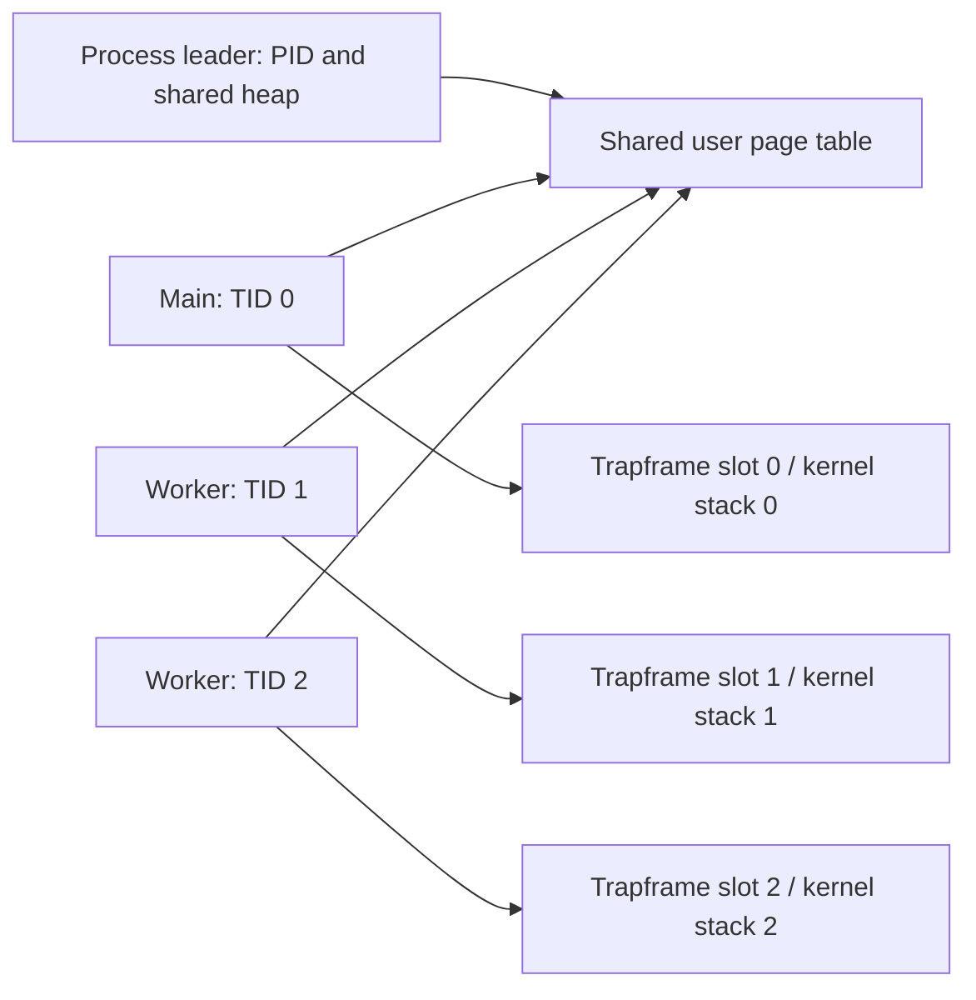

# Threads and synchronization

## Kernel threads (v0.6)

Ordinary xv6 `fork()` creates a separate address space. `kthread_create()` instead creates a schedulable member of the same process: the members share the PID, user page table and heap, while each has its own TID, kernel stack, user stack and trapframe. Up to eight members, including the main thread, are supported.



The trampoline exchanges the saved user register with `sscratch` to select the calling thread's trapframe. Creation publishes a thread only after all its resources are ready. Join reclaims its trapframe and TID slot without freeing the shared address space. A worker returning through the exit stub ends that worker; calling process `exit(status)` from any member ends the group, with the first group exit status preserved for the parent. `kill(pid)` wakes and terminates every member.

| Operation | Original process model | Thread implementation |
|---|---|---|
| Parallel work | Separate processes and memory | Threads share ordinary variables and heap |
| Identity | PID only | Shared PID and per-member TID |
| Waiting | `wait()` for child processes | `kthread_join(tid)` for members; `wait()` for process children |
| Trap return | Fixed trapframe VA | One reserved trapframe VA per member |
| Cleanup | Free one process address space | Reap member resources first, then free group memory |

## Concurrency boundaries

- `exec()` is accepted only in a group containing just its main thread.
- Heap shrink is rejected while multiple members exist. Growth is shared and lazy. Shrink is allowed again after joins.
- A fork from a multi-member group copies resident user pages privately. A single-member fork retains copy-on-write. This avoids changing permissions underneath another CPU's cached translation without a TLB shootdown implementation.
- Eviction is enabled for builds with `CPUS=1`. SMP builds use available RAM and fail allocation on exhaustion; they do not evict pages used by another CPU.
- Each thread starts with references to the creator's file descriptors and current directory. Descriptor-table changes are local to that thread; underlying open-file offsets remain shared through normal xv6 references.
- These educational threads do not implement POSIX TLS, floating-point context management, or general POSIX thread compatibility.

Raw APIs are declared in `user/user.h`: `kthread_create(entry, arg, stack_top, exit_stub)`, `kthread_exit()`, `kthread_join(tid)`, and `kgettid()`. The caller owns its user stack until join succeeds.

See [recorded results](../results/threads/README.md). Futexes and the user library are subsequent milestones.

## Futexes (v0.7)

`futex_wait(address, expected)` sleeps only if the aligned user integer still equals `expected`. `futex_wake(address)` wakes all waiters for that process and exact address, returning the number woken. Different addresses that hash to the same bucket remain distinct, and identical virtual addresses in different processes remain distinct.

```mermaid
sequenceDiagram
  participant W as Waiting thread
  participant K as Kernel bucket lock
  participant S as Signalling thread
  W->>K: Check current value under bucket lock
  K->>K: Enqueue and sleep atomically
  S->>S: Change user value with memory ordering
  S->>K: Wake matching address under same lock
  K->>W: Runnable; recheck predicate
```

Prefaulting happens before the bucket spinlock. The expected-value check and transition to sleep share the lock used by wake, avoiding the check-to-sleep lost-wakeup window. Invalid or unaligned wait addresses return -1; a value mismatch returns immediately. Callers must keep the word allocated while waiters exist and loop around their actual predicate. Waking is not ownership transfer or a promise that the predicate remains true.

Syscall numbers 23–28 are allocated to four thread calls and two futex calls. Number 29 remains available for the teammate's tracing implementation.

## User library (v0.8)

Include `user/thread.h`. `thread_create(function, argument)` allocates a 16 KB stack; return from the function or `thread_exit()` ends the worker. `thread_join(tid)` waits and frees its stack. `thread_self()` returns the group-local TID. Use library joins for library-created threads, and raw joins for raw-created threads; do not mix ownership.

Stack allocation and metadata are serialized internally, including concurrent nested create/join. Join caches the old allocation before sleeping so a reused kernel TID cannot cause the new thread's stack to be freed. A duplicate concurrent join is rejected. This does not make application calls to `malloc/free` thread-safe; those calls must be serialized separately from thread-library allocation, or confined to setup before workers start.

`mutex_t` uses atomic states 0 (free), 1 (locked) and 2 (contended). An uncontended lock/unlock stays in user space; contended callers sleep on a futex. `cond_wait` snapshots a sequence while holding the mutex, unlocks, waits only if that sequence is unchanged, then relocks. Always test the application predicate in a `while` loop. Both signal and broadcast currently wake all matching waiters. `sem_t` combines a mutex, condition and nonnegative initial permit count. Locks are nonrecursive and provide no fairness guarantee.

Before the first SMP worker starts, inherited writable COW pages are made private while the process is still single-threaded. This also prevents a worker from reading an old COW frame through a remote cached translation. No general inter-CPU TLB shootdown is claimed.

After `fork()` from a multi-threaded program, the child should exec or exit before using the user thread library: copied user-space lock state may describe a lock held by a parent thread. Do not reuse a TID after its successful join as a persistent identity.
