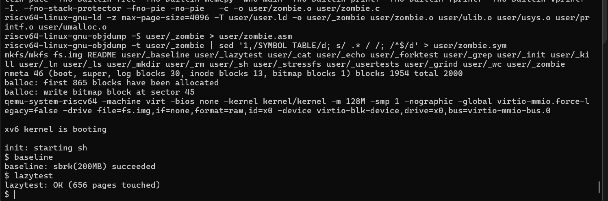
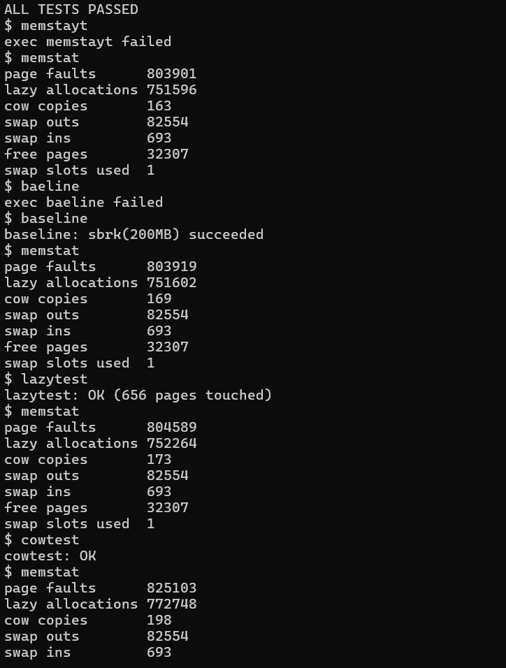
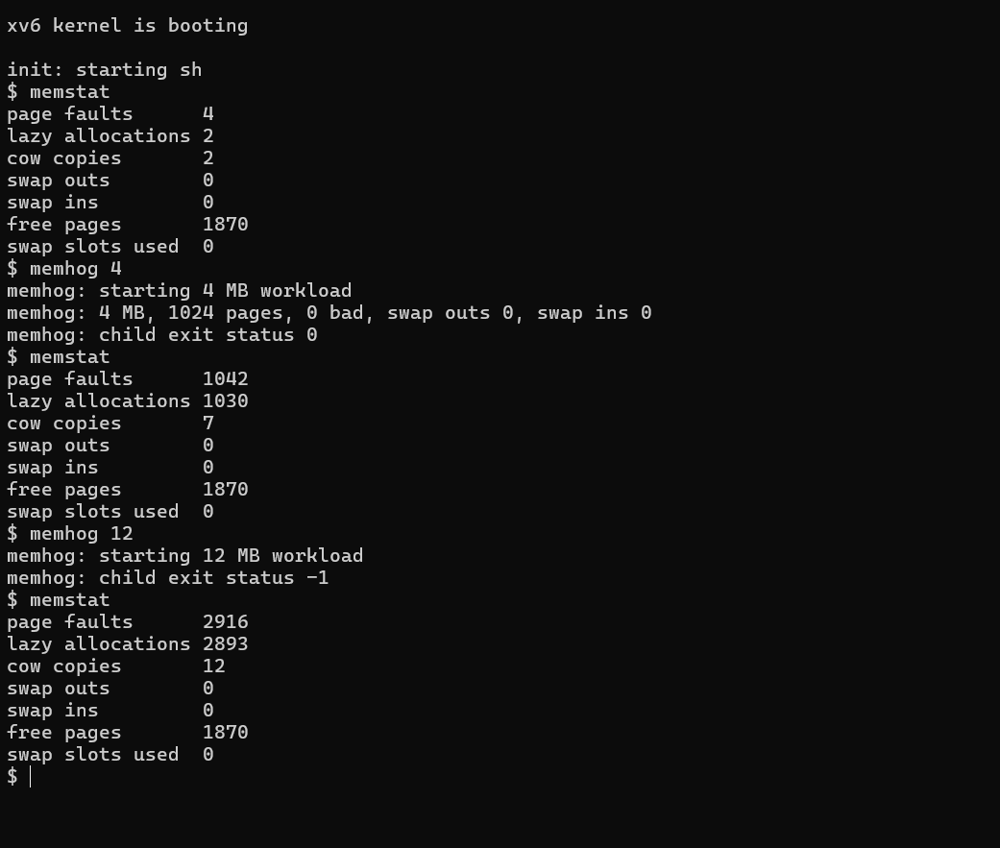
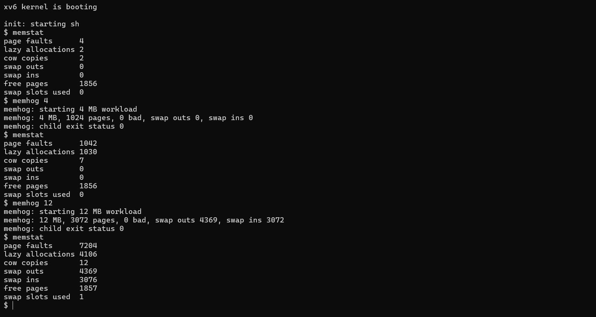
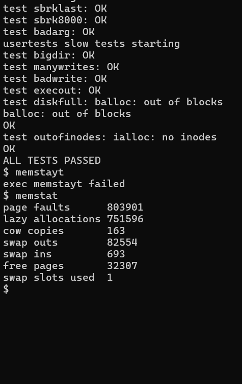
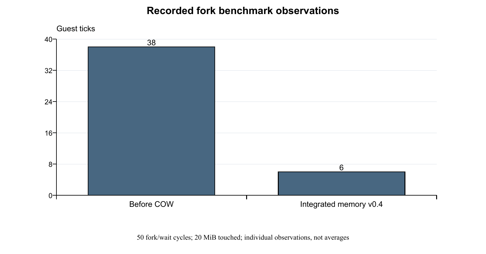
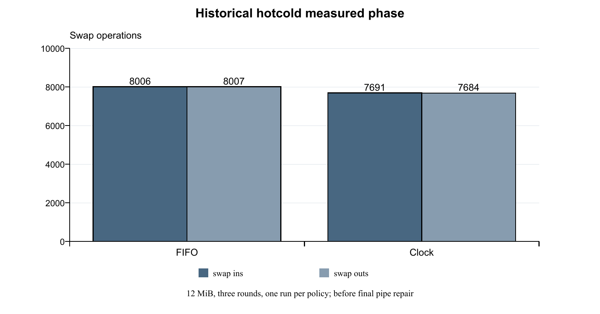

# Memory results

These observations come from saved project runs through the validated `v0.4` memory release. Relevant screenshots are selected below; editor captures, command typos, intermediate patches and duplicate development records are kept in the local report archive.

## Before and after

| Experiment | Earlier behavior | Behavior after the feature | Evidence |
| --- | --- | --- | --- |
| Reserve 200 MB | Eager baseline `v0.0`: allocation failed | Lazy milestone: reservation succeeded | [Lazy result](screenshots/lazy-allocation.png) and [output record](outputs/observed-results.txt) |
| Sparse address space | Eager allocation backs the requested range immediately | Lazy test passed with 656 pages touched | [Lazy result](screenshots/lazy-allocation.png) |
| Large-process fork | Before COW: `cowtest: fork failed` | After COW: `cowtest: OK` | [Before](screenshots/fork-before-cow.png), [after](screenshots/cow-validation.png) |
| Fork benchmark | Before COW: 50 forks of a 20 MB process took 38 ticks | COW-only observations: 3–4 ticks; final integrated v0.4 observation: 6 ticks | [Before](screenshots/fork-before-cow.png), [v0.4 result](screenshots/fork-benchmark.png) |
| 12 MB pressure workload | With 8 MB usable RAM and no swap: child status -1 | With swap: 3,072 pages checked, 0 bad, child status 0 | [Without swap](screenshots/no-swap-pressure.png), [with swap](screenshots/swap-pressure.png) |
| COW while swapping | New interaction requiring validation | `swapfork: child bad=0` and `swapfork: OK` | [Swap and fork](screenshots/swap-fork.png) |
| Final regression | Earlier integration exposed a pipe-copy failure | After the repair: full `usertests` passed | [Regression result](screenshots/regression-tests.png) |

Program sizes labelled MB use 1,024 × 1,024 bytes. The sparse test's touched-page count is not a measurement of the whole process's resident footprint.

## FIFO and Clock comparison

One recorded fresh-boot hot/cold measured phase was captured for each policy with the instructed one-CPU, 8 MB usable-RAM configuration. These runs preceded the final pipe repair.

| Policy | Swap ins during measured phase | Swap outs during measured phase |
| --- | ---: | ---: |
| FIFO | 8,006 | 8,007 |
| Clock | 7,691 | 7,684 |

Clock generated fewer swap operations in these individual runs. No runtime was measured, and this is not evidence that Clock wins on every workload. See the [FIFO capture](screenshots/fifo-hotcold.png) and [Clock capture](screenshots/clock-hotcold.png). The screenshot labels follow the instructed build sequences; the captures do not themselves show the compiler flags.

## Reproduce the experiments

From the Linux repository directory, build the normal memory configuration:

```bash
make clean
make qemu CPUS=1 RAM_MB=128 SWAP_POLICY=1
```

At the xv6 prompt run `memstat`, `baseline`, `lazytest`, `cowtest`, `forkbench`, `usertests`, then `memstat`. Record actual output; a screenshot of `ALL TESTS PASSED` establishes a completed suite for that run.

For memory pressure, exit QEMU and rebuild:

```bash
make clean
make qemu CPUS=1 RAM_MB=8 SWAP_POLICY=1
```

Run `memstat`, `memhog 4`, `memhog 12`, `swapfork` and `memstat`. Repeat a fresh build using `SWAP_POLICY=2`. For policy comparison, run `hotcold` once per fresh boot, with matching configurations and repeated trials for a stronger comparison. Exit QEMU with Ctrl+A, then X.

For historical comparisons use a separate clone or worktree at the relevant tag. Do not switch a checkout containing unfinished implementation edits. Tags `v0.0`, `v0.1`, `v0.2`, `before-swap`, and `v0.4` retain the experiment checkpoints. The comparison programs were added after some early tags, so simply checking out an early tag may not include every later demonstration program.

## Measurement limits

- The historical full-suite and final demo evidence on this page applies to v0.4. Later thread-compatible memory and integrated-main checks are recorded separately in the [thread results](../threads/README.md) and [integration record](../threads/integration.md).
- Swapping is supported with one CPU. `RAM_MB` changes usable xv6 RAM; QEMU remains provisioned with 128 MB.
- Fork timings are individual observations, not repeated statistical measurements. COW-only and final integrated observations remain separate.
- `memstat` includes shell and measurement-command activity. Program snapshots and later shell snapshots can differ.
- Repeated pressure runs showed stable post-run free pages and one used swap slot. The slot's owner was not traced; universal absence of leaks is not established.
- The original upstream test source was not weakened to obtain the final pass.

## Selected captures

<details>
<summary>Lazy allocation and COW correctness</summary>





</details>

<details>
<summary>Pressure before and after swapping</summary>





</details>

<details>
<summary>Final regression result</summary>



</details>

[Observed console excerpts](outputs/observed-results.txt) · [Screenshot provenance](screenshots/README.md) · [Feature explanations](../../features/memory.md)

## Charts and teacher discussion





These charts are authored from the recorded numbers above, not new measurements. They retain the individual-trial and pre-repair policy limits. Read the [draft report](../../reports/memory-management-draft.docx), [teacher demonstration guide](../../presentation/memory.md) and [primary references](../../references.md).
