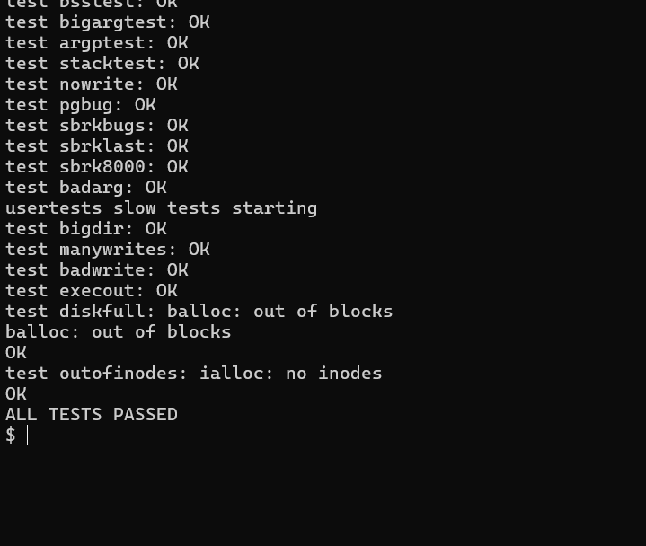

# Thread ready memory validation

These are observed v0.5 candidate results, recorded before its source commit and release tag. The candidate's source diff remained unchanged across the inspected validation sequence. Commands were run by Akshit in Ubuntu/WSL; raw recordings and detailed progress remain in the local report records.

## Tested configurations

| Configuration | Checks | Observed result |
| --- | --- | --- |
| One CPU, 128 MB usable RAM, FIFO | baseline, lazytest, cowtest, forkbench, full usertests | All passed; sparse test touched 656 pages; 50 forks of a 20 MB process took 5 ticks |
| One CPU, 8 MB usable RAM, FIFO | 4 MB control, two 12 MB workloads, swapfork | Control and both 3,072-page runs: zero bad pages and status 0; swapfork child bad=0 and OK |
| One CPU, 8 MB usable RAM, Clock | Same control, repeated pressure and swapfork sequence | Same correctness results: zero bad pages, status 0, swapfork child bad=0 and OK |

## Final resource snapshots

| End of sequence | Free pages | Used swap slots | Swap outs | Swap ins |
| --- | ---: | ---: | ---: | ---: |
| Normal full usertests | 32,306 | 1 | 82,554 | 693 |
| FIFO pressure and swapfork | 1,856 | 1 | 11,577 | 7,692 |
| Clock pressure and swapfork | 1,856 | 1 | 11,118 | 7,222 |

Both 8 MB runs started at 1,855 free pages and zero used slots. After each 12 MB workload and after swapfork, both showed 1,856 free pages and one used slot. This is stable post-run resource use for these sequences. The slot owner remains untraced, so these observations do not prove universal leak freedom. Counters are cumulative and include shell and measurement activity.

The five-tick fork result is an individual v0.5 observation. Keep it separate from the earlier 38-tick pre-COW, 3–4-tick COW-only and six-tick v0.4 observations. The FIFO/Clock counts above are not elapsed-time or repeated statistical comparisons.

## Reproduce

For the normal regression:

```bash
make clean
make qemu CPUS=1 RAM_MB=128 SWAP_POLICY=1
```

At the xv6 prompt, run baseline, lazytest, cowtest, forkbench, memstat, usertests and another memstat. For each pressure policy, exit QEMU, clean and rebuild:

```bash
make clean
make qemu CPUS=1 RAM_MB=8 SWAP_POLICY=1
```

Run memstat, memhog 4, memhog 12, memstat, memhog 12, memstat, swapfork and memstat. Repeat a fresh clean build with SWAP_POLICY=2 for Clock. QEMU is still provisioned with 128 MB; RAM_MB controls usable xv6 RAM.

## Selected evidence

- [Normal full-suite screenshot](screenshots/normal-usertests-pass.png).
- [FIFO repeated pressure and swapfork screenshot](screenshots/fifo-pressure-and-swapfork.png).
- [Observed console excerpts, including Clock](outputs/observed-results.txt). The Clock output is verified in its recorded session; no Clock screenshot was supplied for this selection.



[What changed in the memory code](../../features/thread-ready-memory.md) · [Earlier memory results](../memory/README.md)
